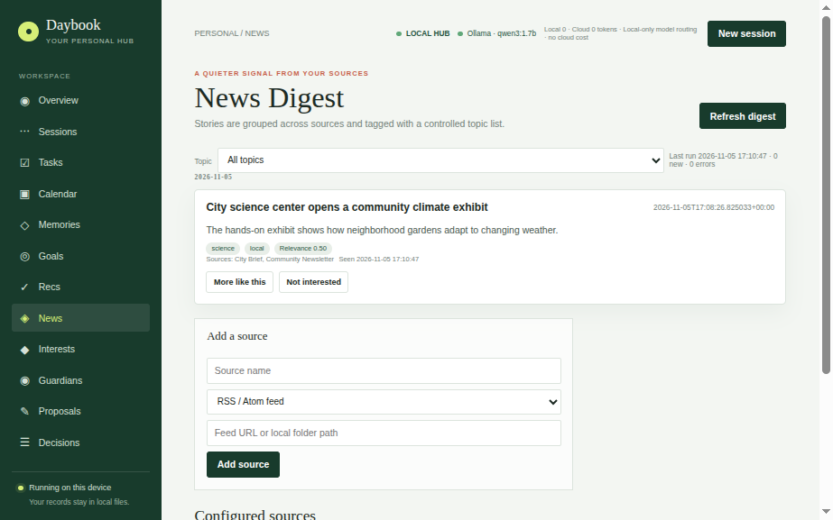
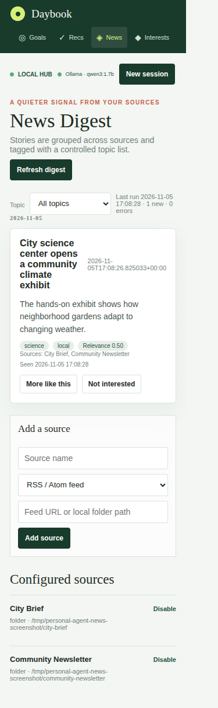

# Personal AI Agent

An open-source, local-first personal agent built with Python, Ollama, and SQLite. It brings conversations, memory, tasks, goals, a multi-source News Digest, an editable Interest Graph, and conservative health checks into one private dashboard.

The project is free and open source. Clone it, adapt it, and run it on your own machine. Ollama is the default model provider; cloud models are optional and disabled unless configured.

## What it does

- **Local conversations and memory:** saved conversations, searchable memories, local document search, explicit command routing, and goal-aware context.
- **Tasks and goals:** due dates, completion history, ignored-task feedback, goal links, and a task calendar.
- **News Digest:** RSS/Atom, web pages, local text/PDF press reviews, and `.eml` newsletter folders. Similar stories are grouped into one card with all contributing sources and controlled topic tags.
- **Interest Graph:** transparent topic weights and connections updated by digest feedback, completed/ignored tasks, and explicitly searched Gmail. Adjust weights in the dashboard.
- **Email and calendar context:** read-only Gmail search and prioritization, goal links where relevant, and read-only local `.ics` events.
- **Guardians:** local disk and directory checks, Ollama HTTP/process health, and optional user-configured HTTP checks. The only automatic repair is recreating the app's local data/log directories; no shell commands or destructive fixes are run.
- **Human-reviewed improvements:** proposals for news sources, Guardian checks, and assistant guidance stay pending until accepted or rejected. Accepted changes are allow-listed and recorded.
- **Transparency:** a local/cloud token meter, estimated cloud cost when rates are configured, and a “why” Decision Log.

## Screenshots

Desktop:



Mobile:



## Install

Requirements: Python 3.10+ and [Ollama](https://ollama.com/) for local model use.

```bash
git clone https://github.com/dariocostanzo/personal-ai-agent.git
cd personal-ai-agent
python3 -m venv .venv
source .venv/bin/activate
python -m pip install -r requirements.txt
cp .env.example .env
ollama pull qwen3:1.7b
```

The default model is `qwen3:1.7b`. Set `OLLAMA_MODEL` in `.env` to a model already installed in Ollama. For local semantic news deduplication, also install an embedding-capable Ollama model and set `OLLAMA_EMBEDDING_MODEL` (the default is `nomic-embed-text`); digest ingestion falls back to local text similarity when embeddings are unavailable.

## Run

Start the browser dashboard from the project directory:

```bash
source .venv/bin/activate
python -m src.agent.web
```

Open <http://localhost:8000>. The server binds to `127.0.0.1`. The in-process scheduler runs while this process is active: it performs a full digest on startup, incremental refreshes on `NEWS_REFRESH_MINUTES`, a scheduled full refresh every `NEWS_FULL_REFRESH_HOURS`, and Guardian checks on `GUARDIAN_CHECK_MINUTES`. Set `AGENT_SCHEDULER_ENABLED=false` to turn the scheduler off. A dashboard refresh is also available on demand.

The terminal agent remains available:

```bash
python -m src.agent.main
```

## Configuration

Copy `.env.example` to `.env`. Secrets and personal data are not tracked by Git.

### News sources

Add sources from the News Digest dashboard or configure `NEWS_SOURCES` as a JSON array:

```dotenv
NEWS_SOURCES=[{"name":"Local paper","kind":"rss","location":"https://example.org/feed.xml"},{"name":"Press review","kind":"folder","location":"~/Documents/press-review"},{"name":"Newsletters","kind":"newsletter","location":"~/Documents/newsletters"}]
```

Supported `kind` values are `rss`, `website`, `folder`, and `newsletter`. Folder ingestion accepts `.txt`, `.md`, `.eml`, and `.pdf`; PDF extraction uses `pypdf`. Keep source paths and fetched content under your control. Web sources are fetched when the local scheduler runs.

The optional `.env` setting `AGENT_CALENDAR_ICS` points to a local iCalendar export (default: `data/calendar.ics`). Calendar files are read-only and are not uploaded.

### Model providers and privacy

Ollama runs locally and is the default:

```dotenv
AGENT_PROVIDER=ollama
AGENT_PROVIDER_CHAT=ollama
AGENT_MODEL_CHAT=
```

OpenAI and Anthropic/Claude are optional. To use one, set `AGENT_PROVIDER_CHAT=openai` or `AGENT_PROVIDER_CHAT=anthropic` and provide the matching API key in `.env`. `AGENT_MODEL_CHAT` overrides that provider's model. `AGENT_FALLBACK_PROVIDER` is empty by default; setting it explicitly enables fallback. A cloud provider receives the conversation context needed for that request. The dashboard identifies local versus cloud usage; token counts are estimated when provider usage is unavailable. Configure `OPENAI_*_COST_PER_MILLION` or `ANTHROPIC_*_COST_PER_MILLION` to show a cost estimate; otherwise cloud cost is labeled unavailable rather than reported as zero.

Provider selection is capability-specific: use `AGENT_PROVIDER_CHAT` and `AGENT_MODEL_CHAT` for chat; `AGENT_PROVIDER_SELF_IMPROVEMENT` and `AGENT_MODEL_SELF_IMPROVEMENT` select the provider for generated improvement proposals. The dashboard's proposal generator defaults to Ollama; generated suggestions are validated and remain pending until explicitly reviewed. `providers.complete(..., capability="...")` is the extension point for a future specialized agent's model choice. No credentials are required for offline Ollama-only use.

### Guardians

`GUARDIAN_DISK_WARNING_PERCENT` sets the disk threshold. On Linux, `GUARDIAN_PROCESSES` is a comma-separated list of process names to check (`ollama` by default). Additional HTTP service checks can be configured from the Guardians dashboard. Checks are read-only apart from the safe recreation of missing project `data/` and `logs/` directories.

## Explicit chat commands

The command router only calls tools for recognized, explicit patterns. Examples:

- `Add task: call dentist | due 2026-11-05`
- `Complete task #1` or `Ignore task #1`
- `What should I do today?`
- `Remember that I prefer decaf coffee`
- `Find documents about the fridge warranty`
- `Search my Gmail for subject:invoice`
- `Show my news digest` or `Refresh news digest`

General chat does not execute task, Gmail, or document operations. Gmail remains read-only. Follow [GMAIL_SETUP.md](./GMAIL_SETUP.md) to set up Gmail's read-only OAuth integration.

## Data and storage

Personal databases and files live under `data/`, which is Git-ignored:

- Existing `tasks.db`, `goals.db`, `sessions.db`, `recommendations.db`, and `memory.db` retain their existing roles.
- `news.db` stores source configuration, grouped story cards, source links, and digest runs.
- `agent_state.db` stores interest weights/events/connections, decisions, proposals, provider usage, and Guardian checks.
- Conversations remain in `conversations.json`; a local calendar export can be placed at `data/calendar.ics`.
- Gmail OAuth credentials and tokens belong in `data/` and remain ignored.

The task store performs a small schema migration to record ignored tasks while preserving existing task history. New data is not sent to a model unless cloud routing is explicitly configured.

## Architecture

`src/agent/router.py` provides a small capability registry. `ai.py` preserves explicit command matching and registers local tools; `providers.py` handles Ollama/OpenAI/Anthropic calls and usage accounting. Specialized modules (`news.py`, `interests.py`, `guardians.py`, `calendar.py`, and `proposals.py`) expose focused extension points without adding processes or replacing existing storage. `web.py` serves the dashboard and JSON APIs; `dashboard.html` remains a self-contained local UI.

## Tests

Run the standard-library unit suite:

```bash
python -m unittest discover -s tests
```

Tests cover existing features as well as digest ingestion/deduplication, interest updates, task migrations, and dashboard APIs. Most tests use temporary SQLite databases and do not require Ollama or Google credentials.

## Privacy and safety

- `.env`, databases, OAuth files, downloaded content, and calendar exports are excluded from Git.
- The dashboard binds to localhost by default.
- Gmail access is read-only and only used for explicit search requests.
- Cloud model use is opt-in. Avoid sending sensitive context to a cloud provider unless you have reviewed its terms and configured it intentionally.
- Proposals are not applied automatically. Unsupported proposal actions are rejected; approved changes are recorded locally.
- News and Guardian URLs are user-configured. Health checks do not execute external commands or modify remote services.

Contributions and extensions are welcome. Keep new capabilities small, explicit, local by default, and covered by tests.
